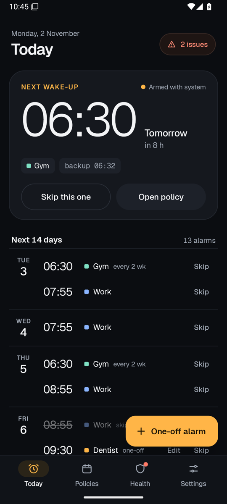
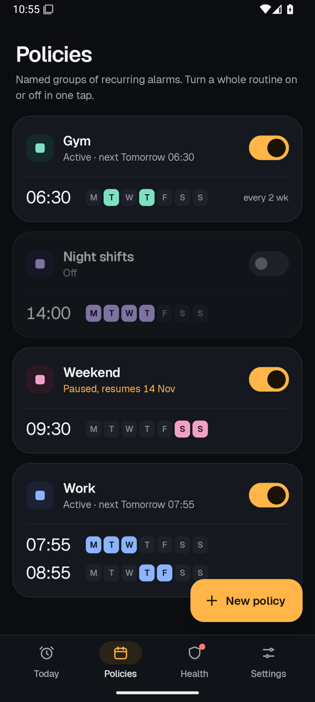
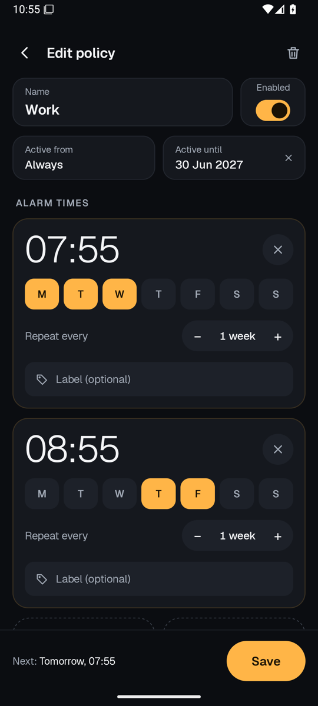
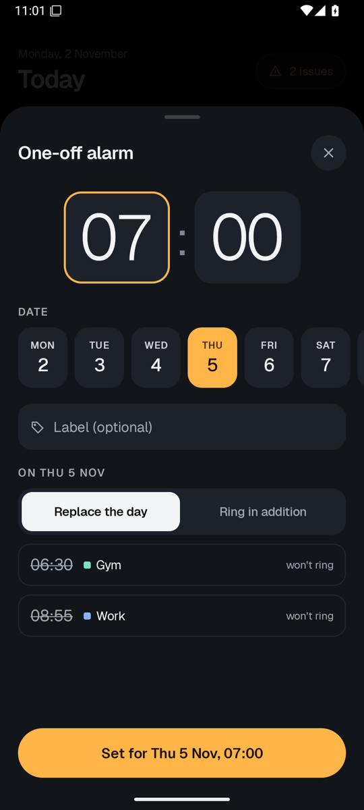
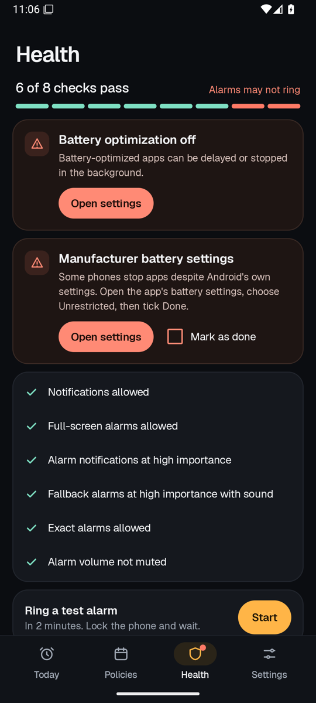
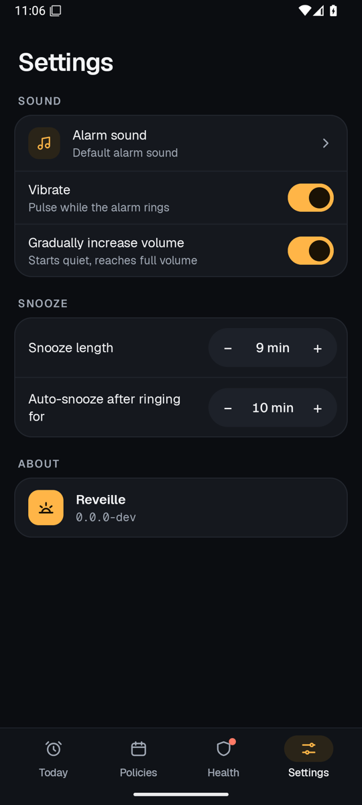
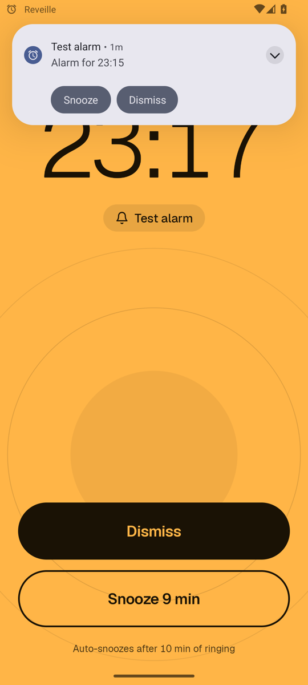
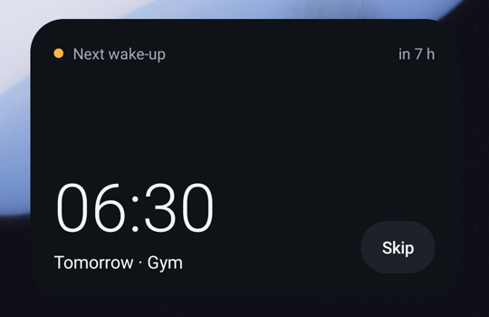
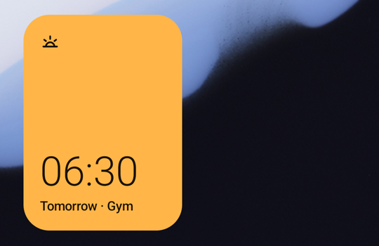
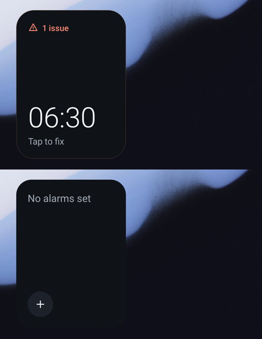

# Reveille

An Android alarm clock for schedules the stock Clock app can't express, built so that a wake-up is never lost silently.

## Screenshots

<p align="center">
  
  
  
  
</p>
<p align="center">
  
  
  
</p>

<p align="center">
  
  
  
</p>

## Features

- **One-off alarms on a date.** "09:30 next Thursday only", with no recurrence. A one-off can either replace that day's recurring alarms or ring in addition to them.
- **Policies.** A named group of recurring rules, for example *Work* = 07:55 Mon–Wed + 08:55 Thu–Fri. Each rule can repeat every N weeks. A policy can have start/end dates and pause ranges (holidays), and you can skip a single day.
- **Home timeline.** The next 14 days at a glance, with Skip, Unskip and Undo.
- **Widget.** Shows the next wake-up, with a Skip button.
- **Reliability.**
  - Uses `setAlarmClock` (the same API the stock Clock app uses) and arms a backup 2 minutes after every alarm.
  - A ring guard re-rings if the app is killed mid-alarm.
  - A fallback notification rings by itself if the ringing service can't start.
  - Alarms work after a reboot, even before the first unlock.
  - Alarms up to 30 minutes late still ring; older ones raise a "Missed alarm" notification.
  - The Health tab walks through Android and Xiaomi HyperOS settings and lets you ring a test alarm.

## Requirements

- Android 12 (API 31) or newer.
- Sideloaded only. It uses `USE_EXACT_ALARM`, which Google Play restricts to dedicated clock apps.

## Build and install

Prerequisites: JDK 17+ and the Android SDK (platform `android-37.0`, build-tools `37.0.0`). Point `local.properties` at the SDK:

```properties
sdk.dir=/path/to/Android/sdk
```

Then:

```bash
./gradlew :app:installDebug          # build and install on a USB-connected phone
./gradlew :engine:test :app:testDebugUnitTest :app:lintDebug   # tests and lint
```

## CI and releases

- **Every pull request** runs unit tests (engine + Robolectric on SDK 31/33/35), Android lint, a debug build (APK attached as an artifact), ShellCheck, and a preview of the release the PR would produce (`.github/workflows/ci.yml`).
- **Every push to `main`** runs CI again. It then computes the next version from [Conventional Commits](https://www.conventionalcommits.org) since the last `vX.Y.Z` tag (`scripts/semver.sh`):

  | Commit | Effect |
  |---|---|
  | `feat` | minor bump |
  | `fix`, `perf` | patch bump |
  | `type!:` or a `BREAKING CHANGE:` footer | major bump |
  | anything else | no release |

  If a release is due, it builds a **signed** release APK, verifies the signature, and publishes a GitHub release `vX.Y.Z`. The release carries `reveille-vX.Y.Z.apk`, its `.sha256` and generated notes (`.github/workflows/release.yml`).
- Version code = `major × 1,000,000 + minor × 1,000 + patch`.

### Signing key (one-time setup)

```bash
scripts/create-release-keystore.sh ~/reveille-release.jks replydev/Reveille
```

The script creates a 4096-bit RSA key valid for 100 years and can store it as the repository secrets `REVEILLE_KEYSTORE_BASE64`, `REVEILLE_KEYSTORE_PASSWORD`, `REVEILLE_KEY_ALIAS` and `REVEILLE_KEY_PASSWORD` (it needs `gh` logged in with access to the repo). **Back up the `.jks` file and its password.** Every update must be signed with the same key, or Android refuses to install it over the existing app. A phone that has a debug build installed must uninstall it once before installing a release.

To build a signed APK locally, set `REVEILLE_KEYSTORE_FILE`, `REVEILLE_KEYSTORE_PASSWORD`, `REVEILLE_KEY_ALIAS` and `REVEILLE_KEY_PASSWORD`, then run `./gradlew :app:assembleRelease`. Without them, the release APK is unsigned.

## First run

1. Grant notification permission when asked.
2. Open **Health** from the bottom bar (the red "issues" pill on Today links there too) and make every item green. On Xiaomi/Redmi/POCO phones that includes Autostart, battery saver "No restrictions", lock-screen and pop-up permissions, and locking Reveille in Recents.
3. Tap **Ring a test alarm in 2 minutes**, lock the phone and wait.

If Reveille is force-stopped, Android deletes its alarms until you open the app again (tapping the widget counts).

## Project layout

| Path | What |
|---|---|
| `engine/` | Pure Kotlin scheduling engine: occurrences, daylight-saving handling, the arm planner, the timeline. No Android dependencies. |
| `app/` | Android app: Room/DataStore storage, alarm delivery, ringing service, widget, Compose UI. |
| `docs/superpowers/specs/` | Design spec. |
| `docs/superpowers/plans/` | Original implementation plan. |
| `docs/reports/` | Build report and the on-device test checklist. |

## Tech

Kotlin · Jetpack Compose (Material 3) · Room · DataStore · WorkManager · Glance · JUnit 4 + Robolectric.

## License

Licensed under the [Apache License, Version 2.0](LICENSE). The bundled Geist and Geist Mono fonts are under the SIL Open Font License 1.1 ([licenses/Geist-OFL.txt](licenses/Geist-OFL.txt)).
